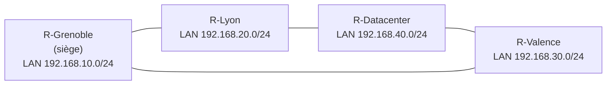

# 🌐 Réseau multi-sites ALPEX en anneau

Maquette d'un réseau d'entreprise reliant quatre sites par des routeurs **Cisco 1941** disposés en **anneau**. Le projet compare trois façons d'acheminer le trafic : le **routage statique**, puis les protocoles dynamiques **RIPv2** et **OSPFv2**.

[⬅ Retour au portfolio](https://github.com/EvanBienvenu/EvanBienvenu)

## Contexte

L'entreprise fictive **ALPEX** possède un siège à Grenoble, deux agences (Lyon et Valence) et un datacenter. Tous les sites doivent pouvoir communiquer, et le réseau doit continuer à fonctionner si un lien tombe.

## Objectifs

- Relier quatre sites distants avec des routeurs Cisco
- Configurer le routage statique, puis RIPv2, puis OSPFv2
- Vérifier la connectivité entre tous les sites
- Observer la reprise automatique en cas de coupure d'un lien

## Topologie



<!-- À vérifier : remplacer le plan d'adressage par celui de la maquette réelle. -->

### Plan d'adressage

| Lien / réseau | Adresse réseau | Rôle |
| --- | --- | --- |
| Grenoble ↔ Lyon | 10.0.0.0/30 | Liaison WAN |
| Lyon ↔ Datacenter | 10.0.0.4/30 | Liaison WAN |
| Datacenter ↔ Valence | 10.0.0.8/30 | Liaison WAN |
| Valence ↔ Grenoble | 10.0.0.12/30 | Liaison WAN |
| LAN Grenoble | 192.168.10.0/24 | Siège |
| LAN Lyon | 192.168.20.0/24 | Agence |
| LAN Valence | 192.168.30.0/24 | Agence |
| LAN Datacenter | 192.168.40.0/24 | Serveurs |

## Configuration

Exemple sur le routeur de Grenoble (les autres routeurs suivent la même logique).

### Étape 1 : routage statique

```cisco
ip route 192.168.20.0 255.255.255.0 10.0.0.2
ip route 192.168.30.0 255.255.255.0 10.0.0.13
ip route 192.168.40.0 255.255.255.0 10.0.0.2
! Route de secours (distance administrative plus élevée)
ip route 192.168.40.0 255.255.255.0 10.0.0.13 10
```

### Étape 2 : RIPv2

```cisco
router rip
 version 2
 no auto-summary
 network 10.0.0.0
 network 192.168.10.0
```

### Étape 3 : OSPFv2

```cisco
router ospf 1
 router-id 1.1.1.1
 network 10.0.0.0 0.0.0.3 area 0
 network 10.0.0.12 0.0.0.3 area 0
 network 192.168.10.0 0.0.0.255 area 0
 passive-interface GigabitEthernet0/0
```

## Tests et vérifications

| Test | Commande | Résultat attendu |
| --- | --- | --- |
| Table de routage | `show ip route` | Les 4 LAN apparaissent |
| Voisins OSPF | `show ip ospf neighbor` | 2 voisins en état `FULL` |
| Connectivité | `ping 192.168.40.1` | Réponses depuis tous les sites |
| Chemin emprunté | `traceroute 192.168.40.1` | Passage par l'anneau |
| Panne d'un lien | `shutdown` sur une interface | Le trafic repasse par l'autre côté de l'anneau |

## Comparaison des méthodes

| Critère | Statique | RIPv2 | OSPFv2 |
| --- | --- | --- | --- |
| Configuration | Manuelle, longue | Simple | Plus détaillée |
| Adaptation aux pannes | Non (sauf route de secours) | Oui, lente | Oui, rapide |
| Choix du chemin | Fixé à la main | Moins de sauts | Meilleur débit |
| Adapté à | Petits réseaux | Réseaux modestes | Réseaux d'entreprise |

## Ce que j'ai appris

- Construire un plan d'adressage cohérent pour plusieurs sites
- Comprendre les limites du routage statique face aux pannes
- Configurer et comparer deux protocoles de routage dynamique
- Diagnostiquer un réseau avec `show`, `ping` et `traceroute`

## Compétences mobilisées

[Routage](https://github.com/EvanBienvenu/competences-reseau/blob/main/02-routage.md) · [Bases de Cisco IOS](https://github.com/EvanBienvenu/competences-reseau/blob/main/01-bases-cisco-ios.md)

## 📖 Termes techniques

| Terme | Explication |
| --- | --- |
| **Routeur** | Équipement qui relie plusieurs réseaux et choisit le chemin des données. |
| **Topologie en anneau** | Chaque site est relié à deux voisins : si un lien tombe, le trafic passe par l'autre côté. |
| **Routage statique** | Routes écrites à la main par l'administrateur. |
| **Distance administrative** | Note de « confiance » d'une route : plus elle est basse, plus la route est prioritaire. Sert à créer des routes de secours. |
| **RIPv2** | Protocole dynamique qui choisit le chemin avec le moins de routeurs traversés (sauts). |
| **OSPFv2** | Protocole dynamique qui choisit le chemin le plus rapide selon le débit des liens. |
| **Area 0** | Zone principale (« dorsale ») d'un réseau OSPF. |
| **Router-ID** | Identifiant unique d'un routeur dans OSPF. |
| **Passive-interface** | Empêche l'envoi de messages de routage vers un LAN où il n'y a pas d'autre routeur. |
| **/30** | Petit réseau de 2 adresses utilisables, idéal pour relier deux routeurs. |

Tous les termes sont aussi expliqués dans le [glossaire du portfolio](https://github.com/EvanBienvenu/EvanBienvenu/blob/main/GLOSSAIRE.md).
